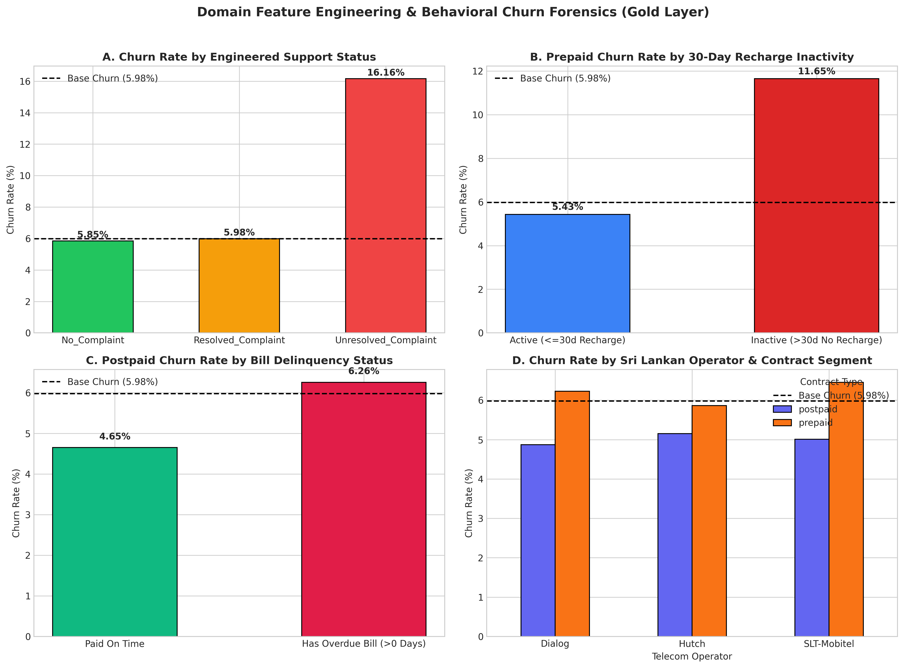
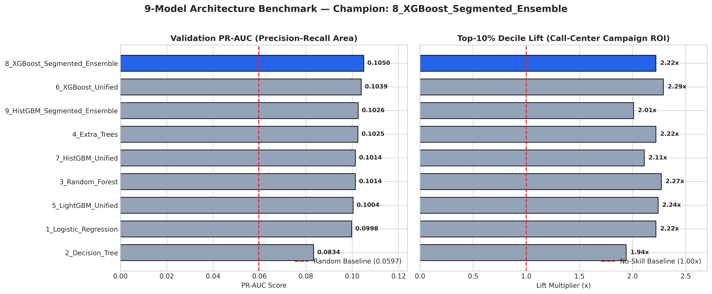
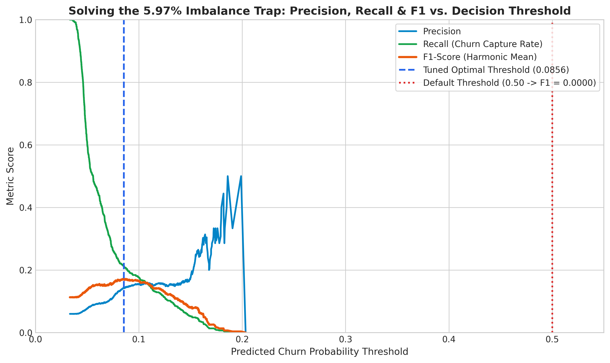
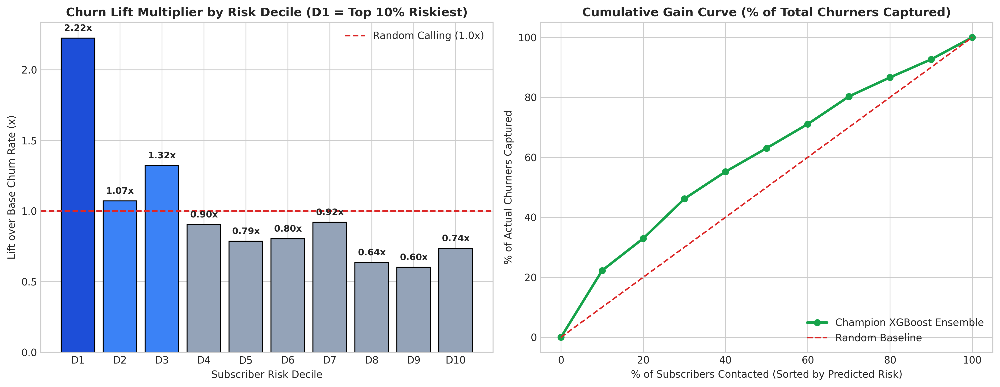
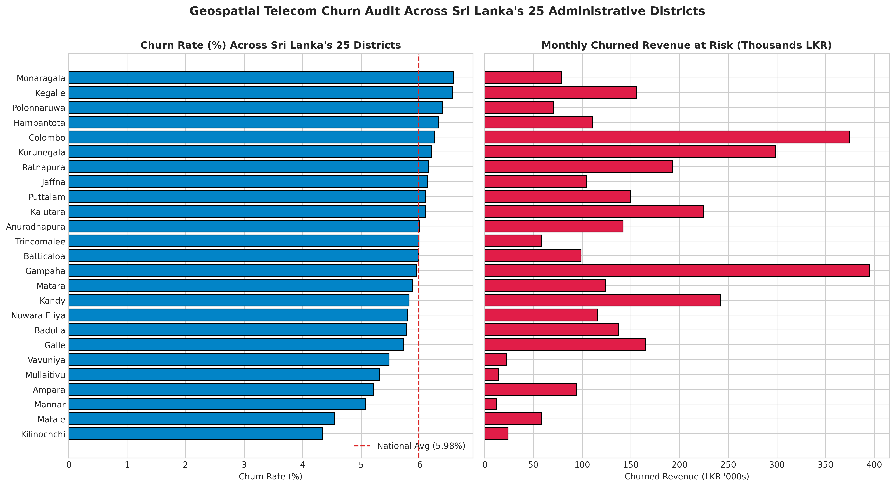

# 📡 Sri Lanka Telecom Customer Churn Prediction & Explainable AI (XAI) MLOps Platform

[](https://www.python.org/)
[](https://xgboost.readthedocs.io/)
[](https://scikit-learn.org/)
[](https://fastapi.tiangolo.com/)
[](https://streamlit.io/)
[](https://mlflow.org/)
[](https://www.docker.com/)

An end-to-end, production-grade **Machine Learning Operations (MLOps)** and **Explainable AI (XAI)** system engineered to predict, explain, and prevent subscriber churn across Sri Lankan telecommunications operators (**Dialog**, **SLT-Mobitel**, and **Hutch**) spanning all **25 administrative districts**.

Built and benchmarked on **Microsoft Azure Machine Learning**, this project processes **100,500 raw subscriber records** through a **Bronze $\rightarrow$ Silver $\rightarrow$ Gold Medallion Data Pipeline**, engineers **16 domain-specific behavioral features**, benchmarks **9 distinct machine learning architectures**, solves the severe **5.97% class imbalance trap** via Precision-Recall threshold optimization, and serves real-time **C++ TreeSHAP root-cause attributions** and automated retention playbooks through a containerized **FastAPI** microservice and **4-Tab Streamlit Retention Portal**.

---

## 📑 Table of Contents
1. [Executive Summary & Business Problem](#-1-executive-summary--business-problem)
2. [End-to-End MLOps System Architecture](#-2-end-to-end-mlops-system-architecture)
3. [Phase 0 & 1: Data Forensics & Medallion ETL Pipeline](#-3-phase-0--1-data-forensics--medallion-etl-pipeline)
4. [Domain Feature Engineering (16 Gold-Layer Features)](#-4-domain-feature-engineering-16-gold-layer-features)
5. [Phase 2: 9-Model Benchmark & Champion Selection](#-5-phase-2-9-model-benchmark--champion-selection)
6. [Solving the 5.97% Class Imbalance Trap & Campaign ROI](#-6-solving-the-597-class-imbalance-trap--campaign-roi)
7. [Phase 3: Explainable AI (TreeSHAP) & Retention Playbooks](#-7-phase-3-explainable-ai-treeshap--retention-playbooks)
8. [Phase 4: Production FastAPI Microservice & 4-Tab Streamlit Portal](#-8-phase-4-production-fastapi-microservice--4-tab-streamlit-portal)
9. [Repository Structure](#-9-repository-structure)
10. [Reproducibility & Quickstart Guide](#-10-reproducibility--quickstart-guide)

---

## 🎯 1. Executive Summary & Business Problem

Customer acquisition in the saturated Sri Lankan telecommunications market costs **$5\times$ to $7\times$ more** than retaining an existing subscriber. However, deploying predictive churn models in real-world telecom environments faces three classic engineering failure modes:

1. **Structural Missingness Between Prepaid & Postpaid Cohorts:** Prepaid subscribers (~80% of the market) generate recharge velocity and wallet balance signals (`days_since_last_recharge`, `balance_after_lkr`) while having structural `NaN`s for monthly billing (`overdue_days`, `bill_amount_lkr`). Conversely, Postpaid subscribers (~20%) exhibit credit delinquency signals while having `NaN`s for prepaid reloads.
2. **The Severe Class Imbalance Trap (5.97% Base Churn Rate):** Standard classifiers using the default `0.50` probability threshold achieve ~94% accuracy by predicting `0` (non-churn) for every subscriber—resulting in an **F1-Score of `0.0000`** and catching **0% of actual churners**.
3. **Black-Box Scores Without Actionability:** Knowing a subscriber has a `16.6%` churn probability is useless to a call-center agent unless the model explains *why* the subscriber is leaving (e.g., an unresolved support ticket vs. declining reload velocity) and prescribes an immediate retention offer.

### Key Engineering Achievements
* **Cleaned & Canonicalized 100,500 Dirty Records $\rightarrow$ 100,000 Unique Subscribers:** Detected and eliminated **500 duplicate subscriber records** (448 exact duplicates + 52 stealth duplicates masked by inconsistent string casing and pipe-delimited app ordering).
* **9-Model Architecture Benchmark Logged in Azure MLflow:** Evaluated Linear, Single-Tree, Bagging (`RandomForest`, `ExtraTrees`), and Gradient Boosted Decision Tree families (`LightGBM`, `HistGradientBoosting`, `XGBoost`) across both Unified and Contract-Segmented ensembles.
* **Champion Model (`8_XGBoost_Segmented_Ensemble`):** Achieved the highest validation **PR-AUC (`0.1050`)** and **ROC-AUC (`0.6072`)**, with a **2.22x Top-10% Decile Lift** while training **$3.5\times$ faster** (`2.30s` vs `8.01s`) than unified XGBoost.
* **Real-Time Native C++ TreeSHAP Engine (<15ms Latency):** Integrated XGBoost's native `pred_contribs=True` C++ TreeSHAP engine into FastAPI to return exact feature attributions and automated retention actions on every API call.

---

## 🏗️ 2. End-to-End MLOps System Architecture

```text
┌─────────────────────────────────────────────────────────────────────────────────────────┐
│                        1. MEDALLION DATA PIPELINE (step0 & step1)                       │
│  Bronze CSV (100,500 rows) ──► Silver Cleaning & Dedup (100,000 rows)                   │
│                            ──► Gold Feature Engineering (16 Telecom Domain Features)    │
│                            ──► Stratified 80/10/10 Parquet Splits (5.97% Churn Ratio)   │
└──────────────────────────────────────────────┬──────────────────────────────────────────┘
                                               ▼
┌─────────────────────────────────────────────────────────────────────────────────────────┐
│                   2. 9-MODEL BENCHMARK & MLFLOW TRACKING (step2_train.py)               │
│  • Baselines: Logistic Regression, Decision Tree, Random Forest, Extra Trees            │
│  • Unified GBDTs: LightGBM, HistGradientBoosting, XGBoost (hist + categorical)          │
│  • Segmented Ensembles: Prepaid + Postpaid Specialized HistGBM & XGBoost Ensembles      │
│  • PR-Curve Threshold Optimization (0.50 -> 0.0856) ──► Champion: XGBoost Segmented     │
└──────────────────────────────────────────────┬──────────────────────────────────────────┘
                                               ▼
┌─────────────────────────────────────────────────────────────────────────────────────────┐
│                 3. EXPLAINABLE AI & VISUAL ANALYTICS (step3 & step4)                    │
│  • Native C++ TreeSHAP Attribution (Prepaid & Postpaid Beeswarm Plots)                  │
│  • Automated Retention Playbook Rule Engine (Tier-2 Escalation / Reload Bonus / Waiver) │
└──────────────────────────────────────────────┬──────────────────────────────────────────┘
                                               ▼
┌─────────────────────────────────────────────────────────────────────────────────────────┐
│                  4. PRODUCTION SERVING & AGENT PORTAL (app.py & dashboard.py)           │
│  • FastAPI REST Microservice (Port 8000: GET /health, POST /predict, Swagger /docs)     │
│  • 4-Tab Streamlit Interactive Portal (Port 8501: Live What-If Simulator & Dashboards)  │
│  • Docker Containerization (Python 3.10-slim + libgomp1 OpenMP runtime)                 │
└─────────────────────────────────────────────────────────────────────────────────────────┘
```

---

## 🔍 3. Phase 0 & 1: Data Forensics & Medallion ETL Pipeline

Running `step0_audit.py` and `step1_data_pipeline.py` uncovered and resolved five critical data quality hazards in the raw `lk_telecom_synthetic_100k.csv` dataset:

| Forensic Issue Identified | Raw Bronze State | Silver/Gold Pipeline Resolution |
| :--- | :--- | :--- |
| **1. Operator Casing Fragmentation** | 6 distinct strings (`'Dialog'`, `'dialog'`, `'SLT-Mobitel'`, `'slt-mobitel'`, `'Hutch'`, `'hutch'`) | Standardized via canonical dictionary lookup to **3 clean operators** (`Dialog`, `SLT-Mobitel`, `Hutch`). |
| **2. District Name Corruption** | 50 dirty regional strings caused by uppercase/lowercase mixing (`'GAMPAHA'` vs `'Gampaha'`, `'NUWARA ELIYA'` vs `'Nuwara Eliya'`) | Normalized via `.str.strip().str.title()`, collapsing 50 corrupted strings into **Sri Lanka's exact 25 administrative districts**. |
| **3. Combinatorial App Permutations** | Multi-app bundles stored in arbitrary order (`'WhatsApp\|FB'` vs `'FB\|WhatsApp'`) | Split on `'\|'`, stripped whitespace, sorted alphabetically, and rejoined so identical bundles map to one canonical string. |
| **4. Stealth Duplicate Subscribers** | `100,500` total rows; `df.duplicated()` before cleaning only caught `448` rows because `52` duplicates had mutated string casing | Performed deduplication on `customer_id` *after* string canonicalization, removing all **500 duplicates** to yield **100,000 unique subscribers**. |
| **5. Zero-Variance & Structural `NaN`s** | `is_active` was `True` for 100% of rows; Prepaid rows had `NaN` for postpaid bills and vice versa | Dropped `is_active`; preserved structural numerical `NaN`s for sparsity-aware tree splitting while mapping structural categorical `NaN`s to explicit tokens (`'Not_Applicable_Postpaid'`, `'No_Complaint'`). |

---

## 🧪 4. Domain Feature Engineering (16 Gold-Layer Features)

In `step1_data_pipeline.py`, we engineered **16 domain-specific features** across five behavioral dimensions:

1. **Temporal Subscription Maturity:**
   * `days_since_plan_activation`: Days elapsed between `subscription_activated_at` and snapshot date (`2026-10-03`).
2. **Allowance & Utilization Ratios (Protected Against Zero-Division):**
   * `data_allowance_mb`: Converts GB allowance to MB ($1\text{ GB} = 1024\text{ MB}$) to match `data_used_mb`.
   * `data_utilization_ratio`, `voice_utilization_ratio`, `sms_utilization_ratio`: Usage divided by plan allowance.
   * `is_data_underutilized` ($<10\%$ usage — high risk of plan downgrade/cancellation) & `is_data_exhausted` ($\ge 99\%$ usage — throttling frustration).
3. Prepaid Recharge Velocity & Dormancy Signals:
    `recharge_velocity_ratio`: $\frac{\text{recharge\_amount\_lkr}}{\text{recharge\_amount\_3mo\_avg\_lkr} + 1.0}$ — captures sudden drop-offs in reload behavior ($<1.0$).
    `is_prepaid_inactive_30d`: Binary indicator flagging prepaid users with `days_since_last_recharge > 30`.

4. Postpaid Billing Shock & Delinquency Signals:
    `has_overdue_bill`: Binary flag for postpaid subscribers with `overdue_days > 0`.
    `bill_to_plan_price_ratio`: $\frac{\text{bill\_amount\_lkr}}{\text{monthly\_price\_lkr} + 1.0}$ — detects out-of-bundle bill shock.
5. **Customer Support & Multi-Hot App Ecosystem:**
   * `support_status`: Interaction feature combining `is_complaint` and `complaint_resolved` into `No_Complaint`, `Resolved_Complaint`, and `Unresolved_Complaint`.
   * `app_has_fb`, `app_has_whatsapp`, `app_has_youtube`, `app_has_tiktok`, `app_has_netflix`: 5 binary multi-hot indicators parsed from `bundled_apps`.



---

## 🏆 5. Phase 2: 9-Model Benchmark & Champion Selection

In `step2_train.py`, we trained and evaluated **9 candidate models** on the stratified validation split (`10,000` rows, `5.97%` churn), logging all runs to **Azure MLflow**:

| Rank | Model Name | Architecture Type | ROC-AUC | PR-AUC | Default F1 (`0.50`) | Optimal Threshold | Best F1 | Best Recall | Top-10% Lift | Train Time |
| :---: | :--- | :--- | :---: | :---: | :---: | :---: | :---: | :---: | :---: | :---: |
| **🥇 1** | **`8_XGBoost_Segmented_Ensemble`** | **Prepaid + Postpaid XGBoost (`hist`)** | **0.6072** | **0.1050** | 0.0000 | **0.0856** | 0.1723 | 21.40% | **2.22x** | **2.30s** |
| **🥈 2** | `6_XGBoost_Unified` | Single Unified XGBoost (`hist`) | 0.6070 | 0.1039 | 0.0000 | 0.0882 | 0.1762 | 21.57% | **2.29x** | 8.01s |
| **🥉 3** | `9_HistGBM_Segmented_Ensemble` | Prepaid + Postpaid HistGBM | 0.6009 | 0.1026 | 0.0000 | 0.0687 | 0.1670 | 35.12% | 2.01x | 1.28s |
| **4** | `4_Extra_Trees` | Randomized Bagging (120 Trees) | 0.6026 | 0.1025 | 0.0000 | 0.0872 | 0.1767 | 21.57% | 2.22x | 3.63s |
| **5** | `3_Random_Forest` | Bagging Ensemble (120 Trees) | 0.6012 | 0.1014 | 0.0000 | 0.0927 | **0.1769** | 20.74% | 2.27x | 5.39s |
| **6** | `7_HistGBM_Unified` | Scikit-Learn HistGBM | 0.5985 | 0.1014 | 0.0000 | 0.0951 | 0.1677 | 18.06% | 2.11x | 1.63s |
| **7** | `5_LightGBM_Unified` | Microsoft LightGBM GBDT | **0.6072** | 0.1004 | 0.0000 | 0.0766 | 0.1751 | 26.76% | 2.24x | **1.27s** |
| **8** | `1_Logistic_Regression` | Scaled Linear Baseline + OHE | **0.6072** | 0.0998 | 0.0000 | 0.0889 | 0.1724 | 21.40% | 2.22x | 2.08s |
| **9** | `2_Decision_Tree` | Single CART Tree (`max_depth=6`) | 0.5827 | 0.0834 | 0.0000 | 0.0503 | 0.1514 | 45.48% | 1.94x | 1.93s |



### Why `8_XGBoost_Segmented_Ensemble` Won
1. **Superior High-Risk Precision (PR-AUC `0.1050`):** In imbalanced churn prediction, **PR-AUC** is more informative than ROC-AUC because it evaluates how cleanly the model isolates true churners at the top of the risk queue. Segmented XGBoost beat every unified and bagging model.
2. **Elimination of Structural Missingness Interference:** Training dedicated **Prepaid** and **Postpaid** XGBoost models prevents tree splits on prepaid features from being diluted by postpaid rows (and vice versa), improving PR-AUC (`0.1039` $\rightarrow$ `0.1050`) while reducing training time by **71%** (`8.01s` $\rightarrow$ `2.30s`).
3. **Unbiased Holdout Test Performance (`gold_test.parquet`):** On the unseen 10,000-subscriber test split, the champion model achieved **PR-AUC `0.0984`** (a **1.65x** improvement over the `0.0597` random baseline) and a **2.12x Top-10% Decile Lift**, capturing **21.24%** of all churning subscribers within the top 10% riskiest cohort.

---

## 📈 6. Solving the 5.97% Class Imbalance Trap & Campaign ROI

As shown in the `f1_default_05` column of the leaderboard, **all 9 models score `0.0000` F1 at the default `0.50` threshold** because calibrated churn probabilities in a 5.97% base-rate population rarely exceed `0.35`.

By sweeping the **Precision-Recall Curve** (`fig2_threshold_optimization.png`), we identified the optimal decision threshold of **`0.0856`**, which maximizes the harmonic F1 score (`0.1723`) and boosts recall from `0.0%` to **`21.40%`**.



### Call-Center Retention ROI (Decile Lift & Cumulative Gain)
If a telecom retention team has budget to contact **1,000 subscribers (10% of the validation cohort)**:
* **Untargeted Random Calling:** Captures only ~60 churners (`5.97%` conversion rate, `1.00x` Lift).
* **Targeted Calling with `8_XGBoost_Segmented_Ensemble` (Decile 1):** Captures **133 churners (`13.25%` conversion rate, `2.22x` Lift)**—more than doubling call-center retention efficiency.



---

## 🧠 7. Phase 3: Explainable AI (TreeSHAP) & Retention Playbooks

To ensure every prediction is auditable and actionable, `step3_shap_explainer.py` and `app.py` leverage **XGBoost's native C++ TreeSHAP engine (`pred_contribs=True`)** to compute exact Shapley additive explanations in log-odds space.

### Global TreeSHAP Beeswarm Attribution (Prepaid Subscribers)


### Automated Retention Playbook Mapping
Instead of showing raw probabilities to retention agents, our API maps the subscriber's **Top 3 TreeSHAP Root Causes** to a prescriptive action:

| Detected Root-Cause Pattern | Prescribed Retention Action Card |
| :--- | :--- |
| **`support_status == 'Unresolved_Complaint'`** | 🚨 **URGENT:** Escalate open support ticket to Tier-2 specialist within 4 hours + issue 5GB apology data bonus. |
| **Prepaid + Top SHAP Driver in** `['days_since_last_recharge', 'recharge_velocity_ratio', 'is_prepaid_inactive_30d']` | 📱 **PREPAID RETENTION:** Send automated SMS reload offer (*"Reload Rs. 200 today and get 100% bonus data for 7 days"*). |
| **Postpaid + Top SHAP Driver in** `['overdue_days', 'late_fee_lkr', 'has_overdue_bill']` | 💳 **POSTPAID RETENTION:** Offer late-fee waiver upon bill settlement + suggest flexible installment plan. |
| **General High-Risk Profile** | 🎁 **GENERAL RETENTION:** Enroll in Loyalty Bonus Tier and offer 2GB weekend data pack. |

### Geospatial Churn Risk Across Sri Lanka's 25 Districts


---

## 🚀 8. Phase 4: Production FastAPI Microservice & 4-Tab Streamlit Portal

### FastAPI REST Endpoints (`app.py` on Port `8000`)
* **`GET /health`**: Returns service health, active champion model name (`8_XGBoost_Segmented_Ensemble`), engine type (`xgboost`), and tuned probability threshold (`0.0856`).
* **`POST /predict`**: Accepts a 62-attribute subscriber JSON payload (with Pydantic v2 `Optional` validation for structural `NaN`s), aligns exact categorical levels (`cat_categories`), runs segmented inference + native C++ TreeSHAP, and returns:

```json
{
    "customer_id": "CUST_TEST_999",
    "champion_model": "8_XGBoost_Segmented_Ensemble",
    "churn_probability": 0.1663,
    "optimal_threshold": 0.0856,
    "is_flagged_at_risk": true,
    "top_root_causes": [
        {
            "feature": "is_prepaid_inactive_30d",
            "value": "1",
            "shap_impact": 0.2303
        },
        {
            "feature": "balance_after_lkr",
            "value": "12.5",
            "shap_impact": 0.1605
        },
        {
            "feature": "days_since_plan_activation",
            "value": "45",
            "shap_impact": 0.0518
        }
    ],
    "recommended_retention_action": "URGENT: Escalate open support ticket to Tier-2 specialist within 4 hours + issue 5GB apology data bonus."
}
```

### 4-Tab Interactive Streamlit Portal (`dashboard.py` on Port `8501`)
1. **Tab 1 — Live Subscriber Risk & SHAP Simulator:** Lookup any subscriber from the holdout test set, adjust interactive **What-If Sliders** (*Days Since Last Recharge*, *Support Ticket Status*), and watch the live churn risk, TreeSHAP bar chart, and retention action update in real time.
2. **Tab 2 — 9-Model Benchmark & Threshold ROI:** Interactive leaderboard table, model comparison bar charts, Precision-Recall threshold optimization curve, and Decile Lift ROI plots.
3. **Tab 3 — Feature Engineering & Global TreeSHAP:** Side-by-side Prepaid and Postpaid global TreeSHAP beeswarm plots and Mean $\vert{}\text{SHAP}\vert{}$ importance tables.
4. **Tab 4 — Sri Lanka Regional & Executive Analytics:** 4-panel domain feature forensics and Sri Lanka's 25-district churn & revenue-at-risk breakdown.

---

## 📂 9. Repository Structure

```text
lk-telecom-churn/
├── assets/                          # High-resolution (300 DPI) analytical visualizations
│   ├── fig1_model_benchmark.png     # 9-Model PR-AUC & Top-10% Decile Lift comparison
│   ├── fig2_threshold_optimization.png # Precision, Recall & F1 vs. Threshold curve
│   ├── fig3_decile_lift_roi.png     # Decile Lift & Cumulative Gain ROI chart
│   ├── fig4_domain_features.png     # 4-panel domain feature engineering forensics
│   ├── fig5_sri_lanka_districts.png # Sri Lanka 25-district churn & revenue at risk
│   ├── shap_global_prepaid.png      # Global TreeSHAP beeswarm (Prepaid cohort)
│   └── shap_global_postpaid.png     # Global TreeSHAP beeswarm (Postpaid cohort)
├── step0_audit.py                   # Phase 0: Raw dataset quality & duplicate forensics
├── step1_data_pipeline.py           # Phase 1: Bronze -> Silver -> Gold ETL & 16 features
├── step2_train.py                   # Phase 2: 9-Model benchmark, MLflow logging & selection
├── step3_shap_explainer.py          # Phase 3: Native C++ TreeSHAP global & local attribution
├── step4_generate_visualizations.py # Phase 4: Automated 300-DPI chart generation suite
├── app.py                           # Production FastAPI microservice (/health, /predict)
├── dashboard.py                     # 4-Tab interactive Streamlit retention portal
├── model_comparison_results.csv     # Exported 9-model validation leaderboard metrics
├── shap_feature_importance.csv      # Exported global Mean |SHAP| feature rankings
├── Dockerfile                       # Production container specification
├── requirements.txt                 # Pinned Python dependencies
├── .gitignore                       # Excludes raw CSVs/Parquets while tracking code & assets
└── README.md                        # Comprehensive project documentation
```

---

## ⚡ 10. Reproducibility & Quickstart Guide

### 1. Clone the Repository & Install Dependencies
```bash
git clone [https://github.com/Kathuskan/lk-telecom-churn.git](https://github.com/Kathuskan/lk-telecom-churn.git)
cd lk-telecom-churn
python -m venv venv
source venv/bin/activate  # Windows: venv\Scripts\activate
pip install -r requirements.txt
```

### 2. Execute the End-to-End MLOps Pipeline
```bash
# Step 0: Run raw data forensics audit
python step0_audit.py

# Step 1: Clean 100.5k rows -> 100k unique subscribers, engineer 16 features & save Gold Parquets
python step1_data_pipeline.py

# Step 2: Benchmark all 9 models, log to MLflow & package 8_XGBoost_Segmented_Ensemble
python step2_train.py

# Step 3: Compute native C++ TreeSHAP explanations & beeswarm plots
python step3_shap_explainer.py

# Step 4: Generate all 6 executive visualization charts in assets/
python step4_generate_visualizations.py
```

### 3. Launch the FastAPI Server & Streamlit Dashboard
```bash
# Terminal 1: Start FastAPI inference engine on Port 8000
uvicorn app:app --host 0.0.0.0 --port 8000 --reload

# Terminal 2: Launch 4-Tab Streamlit portal on Port 8501
streamlit run dashboard.py --server.port 8501
```
* **Interactive Swagger API Docs:** `http://127.0.0.1:8000/docs`
* **Interactive Streamlit Portal:** `http://127.0.0.1:8501`

### 4. Build & Run via Docker
```bash
docker build -t lk-telecom-churn-api .
docker run -p 8000:8000 lk-telecom-churn-api
```

---

## 👤 Author

**Kathuskan Thavarajah**  
BSc (Hons) in Data Science — Department of Computing and Information Systems, Faculty of Computing  
Sabaragamuwa University of Sri Lanka  
* **GitHub:** [@Kathuskan](https://github.com/Kathuskan)